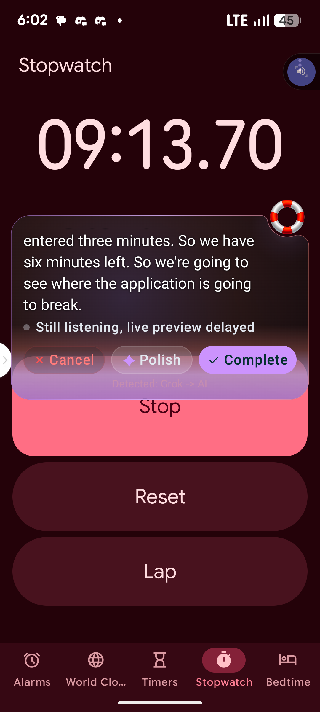

# Rapcha


Rapcha is an Android voice keyboard and floating dictation bubble. You talk, it transcribes, it can polish the text with Gemini, and it types the result into the app in front of you.



**Current version:** 24 (`lite-24`), package `com.princeniithompson.rapcha`. Not on the Play Store yet.

## What it does

- A floating bubble sits over other apps. Tap it, speak, and Rapcha types into the focused field.
- It can also run as a voice keyboard (input method).
- On ordinary phones the polish path has three steps: the raw transcript, then Gemini 3.5 Smart, then Lyra on Gemini 3.8 Live — and only when the target is an AI app. Chef stays in the system instruction; Lyra is the user instruction.
- **Lite mode** is for weak phones (low RAM, budget chips, or a slow CPU). In Lite, Rapcha only records, runs Smart polish, types the text, and finishes. It does not run app detection, Live/Lyra, or extra chrome. You can force Lite on or off in settings; Auto turns it on when the device looks weak.
- Smart Safe Mode can hide the bubble on banking and password screens.
- The Gemini API key is entered by the user in the app (onboarding or settings). It is stored in an on-device encrypted vault. No key is embedded in this repository or in the APK.

## Repository layout

```
app/                  Android app module
  src/main/
    AndroidManifest.xml
    java/com/princeniithompson/rapcha/
      RapchaApplication.kt   Process start; decides Lite mode before heavy work
      MainActivity.kt        Hosts the in-app screens
      audio/                 Microphone capture and filter-bank helpers
      config/                RapchaConfig.kt — models, timeouts, shared constants
      core/                  API key vault, key resolution, Lite mode
      data/                  History, vocabulary, logs, retry clips, English lexicon
      diagnostics/           Crash reports, bubble health, network/device info
      service/               Bubble, accessibility, keyboard, app detection, safe mode
        floating/            Dictation session, Smart/Lyra polish, text injection, overlay
      ui/                    Jetpack Compose screens and bubble UI
        screens/onboarding/  First-run permissions and Gemini key setup
      util/                  App name / package resolution
      websocket/             Gemini Live WebSocket client and transcript handling
    res/                     Drawables, layouts, strings, font, accessibility and IME XML
    assets/scowl/            English word list used by vocabulary features
    baseline-prof.txt        Baseline profile for release startup
  src/test/                  Unit tests (no device required)
  build.gradle.kts           App version, SDK levels, signing hooks, dependencies
  proguard-rules.pro         R8 rules for release
docs/                        Engineering notes and README images
gradle/                      Version catalog and Gradle wrapper
build.gradle.kts             Root plugins
settings.gradle.kts          Project name and module list
gradle.properties            Gradle JVM and Android flags
.env.example                 Placeholder only (GEMINI_API_KEY=MY_GEMINI_API_KEY)
metadata.json                Google AI Studio project metadata
```

Useful files if you are changing behaviour:

- Three-step / Smart / Lyra policy: `service/floating/` (`FloatingPolishCoordinator.kt`, `LyraPolishInstruction.kt`, `Stage2LivePolish.kt`) and `config/RapchaConfig.kt`
- Lite mode: `core/LiteMode.kt` and `service/floating/RenderBudget.kt`
- Typing into other apps: `service/floating/FloatingTextInjector.kt`, `service/RapchaAccessibilityService.kt`, `service/RapchaInputMethodService.kt`
- Live transcription socket: `websocket/GeminiLiveWebSocketClient.kt`
- API key: `core/ApiKeyVault.kt`, `core/ApiConfig.kt`

## How to build

You need:

- **JDK 17 or newer.** This tree was verified with Temurin 21. The Android compile options target Java 11. Kotlin is 2.2.10; the Android Gradle Plugin is 9.1.1.
- **Android SDK** with platform **36** (and 36.1 if your SDK manager offers it). Set the path in a local `local.properties` file (this file is gitignored):

  ```
  sdk.dir=/path/to/Android/Sdk
  ```

  Android Studio writes this for you.

Debug build (unsigned except for the usual local debug keystore):

```bash
./gradlew assembleDebug
```

The debug APK lands at `app/build/outputs/apk/debug/`. Do not commit APKs.

A local `debug.keystore` at the repo root is used for debug signing, with the standard Android debug alias and password already in `app/build.gradle.kts`. If the file is missing, generate one with `keytool` (and leave it uncommitted).

### Release signing

Release builds are minified with R8 and resource shrinking. Signing is **not** in this repo. The build reads these environment variables and will refuse to assemble a release without them:

- `KEYSTORE_PATH` — path to your `.jks` / `.keystore` file
- `STORE_PASSWORD`
- `KEY_PASSWORD`
- `KEY_ALIAS` — optional, defaults to `upload`

Keep the keystore, `keystore.properties`, `store.pass`, and `.env` on your machine only. They are listed in `.gitignore`.

## Gemini API key

The app never ships with a real key.

- The user pastes their own Gemini key during onboarding or in settings.
- `ApiKeyVault` encrypts it with the Android Keystore and stores it on the device.
- `ApiConfig.resolveApiKey()` uses that vault (or a manual setting). It does not fall back to `BuildConfig`.
- The Secrets Gradle plugin is configured to ignore `GEMINI_API_KEY`, so a local `.env` cannot leak a key into `BuildConfig`.
- `.env.example` only contains the placeholder `MY_GEMINI_API_KEY`.

Tests may use obvious fakes, or `AQ.FakeUnitTestKeyNotReal000000000000000000000`. Those are not real keys.

## Notes for AI agents (Google AI Studio and others)

- This repository is the clean v24 starting point. Do not pull history or files from the older `princeniithompson/Vs` repo unless the owner asks.
- Do not commit secrets, keystores, `local.properties`, `.env`, APKs, or AI Studio screenshot dumps.
- Do not change the Chef system instruction or the Lyra user instruction unless the owner explicitly asks. Chef belongs only in the system instruction.
- On normal phones, keep the three-step path: raw text, then Gemini 3.5 Smart, then Lyra on Gemini 3.8 Live for AI apps only.
- Lite mode must stay a thin path: talk, Smart polish, inject, finish.
- Prefer small, focused diffs. Run `./gradlew test` and `./gradlew assembleDebug` after behaviour changes when you can.
- The application id and namespace are `com.princeniithompson.rapcha`.

## License

TBD.
